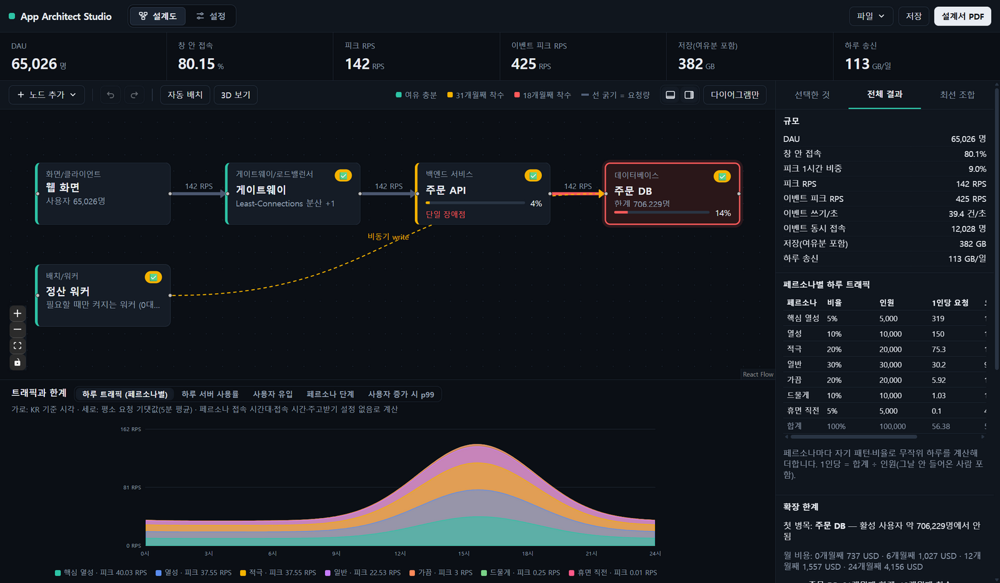
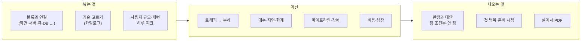

# App Architect Studio

앱을 만들기 전에 구조를 설계하고, 그 구조가 예상 사용자 규모에서 버티는지 미리 계산해 보는 도구입니다. 화면·게이트웨이·서버·큐·DB 같은 블록을 캔버스에 놓고 연결하면, 고른 기술마다 되는지·조건부인지·안 되는지와 더 나은 대안을 알려 줍니다. 트래픽, 필요한 서버 수, 비용, 한계 시점, 확인할 법 조문까지 계산해 설계서(PDF)로 내보냅니다.



## 한눈에 보기



## 문서

| 문서 | 내용 |
|---|---|
| [설계도 화면](docs/design.md) | 캔버스(블록·연결·세부 구성·와이어프레임), 아래 그래프, 오른쪽 결과 패널(선택한 것·전체 결과·최선 조합) |
| [설정 화면](docs/settings.md) | 규모, 하루 피크·업종, 페르소나, 행동, 데이터 주고받기, 성장, 비용 기준, 장애 목표 |
| [계산 방식](docs/model.md) | 트래픽, 용량·한계, DB, 데이터 파이프라인·자동 확장, 장애(존·리전·백업), 비용, 판정 규칙 |
| [저장 · 불러오기 · 설계서](docs/files.md) | 파일 메뉴, 자동 저장·복구, 설계서 PDF, 단축키, 명령줄 |

## 설치 (Windows)

1. [Releases](https://github.com/jinhangcho-ops/app-architect-studio/releases)에서 최신 `App-Architect-Studio-Setup-<버전>.exe`를 받습니다.
2. 실행하면 설치 창이 열립니다.
   - 설치 위치를 고릅니다 (기본: `C:\Users\<이름>\AppData\Local\Programs\App Architect Studio`).
   - 마지막 화면에서 **바탕화면에 바로가기 만들기**를 켜거나 끕니다.
3. 시작 메뉴나 바탕화면 바로가기로 실행합니다. 지울 때는 Windows **설정 › 앱**에서 "App Architect Studio"를 제거합니다.

> 설치 파일은 아직 코드 서명이 없어서, 처음 실행할 때 "Windows의 PC 보호" 창이 뜰 수 있습니다. **추가 정보 › 실행**을 누르세요.

> **받은 설치 파일 확인 (권장):** Releases에는 설치 파일과 같은 이름의 `.sha256` 파일(설치 파일의 지문)이 함께 있습니다. 둘을 같은 폴더에 받은 뒤, 그 폴더에서 PowerShell을 열고 아래 한 줄을 실행하세요. 버전 숫자는 받은 파일에 맞게 바꿉니다.
>
> ```powershell
> $f = "App-Architect-Studio-Setup-1.0.0.exe"; if ((Get-FileHash $f).Hash -eq (Get-Content "$f.sha256").Split(' ')[0]) { "일치: 올린 파일 그대로입니다" } else { "다름: 설치하지 말고 다시 받으세요" }
> ```
>
> "다름"이 나오면 받는 도중 파일이 깨졌거나 누군가 바꾼 것입니다. 이 지문은 같은 Releases 페이지에서 받으므로, Releases 자체가 바뀌는 경우까지 막지는 못합니다.

> **화면 보안(CSP):** 설치 앱은 화면이 앱 안 파일만 불러오도록 Content-Security-Policy를 겁니다. 가져온 HTML에 스크립트가 섞여 있어도 실행되지 않고, 바깥 주소로 데이터를 보내지 못합니다.

> **바깥으로 나가는 요청:** 앱이 스스로 보내는 것은 새 버전 확인 하나뿐입니다. 앱을 열 때 GitHub Releases API에 최신 버전을 한 번 묻고(프로젝트·데이터 값은 보내지 않음), **파일 › 새 버전 확인**에서 끌 수 있습니다. 새 버전이 있으면 **업데이트**를 눌렀을 때만 설치 파일을 받고, Release의 지문(.sha256)과 GitHub가 계산한 지문이 둘 다 맞을 때만 설치 프로그램을 띄웁니다.

> **앱 파일 변조 검사:** 앱 코드 묶음(`resources/app.asar`)의 지문(SHA-256)이 실행 파일에 들어 있어, 실행할 때마다 Electron이 대조합니다. 한 바이트라도 바뀌었거나 묶음 대신 다른 코드 폴더를 넣으면 앱이 열리지 않습니다. **설치 후 앱이 바로 꺼지면 앱 파일이 손상되거나 바뀐 것이니 최신 설치 파일로 다시 설치하세요.** 코드 서명이 없는 동안에는 실행 파일 자체를 고치는 공격까지는 막지 못합니다.

브라우저에서 바로 써 보려면 아래 [개발](#개발)의 `npm run dev`를 쓰면 됩니다.

## 개발

Node 24가 필요합니다.

```bash
npm install
npx install-electron   # 데스크톱 실행용 Electron 런타임 받기 (한 번만)
npm run dev            # 브라우저에서 개발 화면 (http://localhost:5173)
npm test               # 테스트
npm run judge -- examples/phase3.json   # 명령줄에서 예시 프로젝트 계산
npm run desktop        # 데스크톱 앱으로 실행
npm run installer      # release/ 폴더에 설치 파일 만들기
```

새 버전을 배포하려면 `package.json`의 `version`을 올리고 같은 이름의 태그(예: `v1.0.1`)를 올립니다. GitHub Actions가 테스트를 돌린 뒤 Release를 초안으로 만들어 설치 파일과 지문(`.sha256`)을 올리고, 파일이 모두 올라가면 공개합니다.

## 라이선스

[Apache License 2.0](LICENSE)을 따릅니다. 저작권 표시는 [NOTICE](NOTICE)에 있습니다.

카탈로그의 가격·기준값 일부는 형식 확인용 예시값이며, 법령 표시는 "확인할 조문"을 알려 줄 뿐 법률 검토를 대신하지 않습니다.
