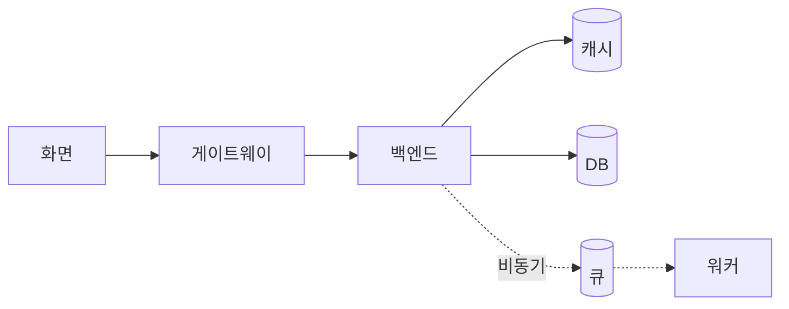
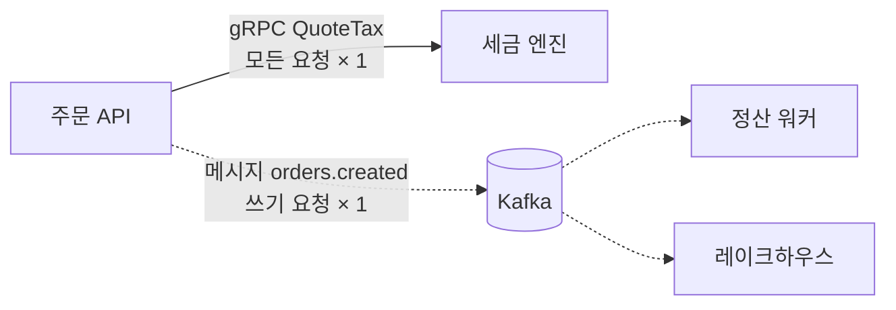

# 설계도 화면

위쪽 **설계도 / 설정**에서 설계도를 고르면 나오는 화면입니다.

```
┌──────────────────────────────────────────────────────────────┐
│ 파일 · 저장 · 설계서 PDF        [설계도 | 설정]      노드 추가 │
├───────────────────────────────────────────┬──────────────────┤
│                                           │ 선택한 것        │
│   캔버스                                   │ 전체 결과        │
│   화면 → 게이트웨이 → 서버 → 큐 → DB        │ 최선 조합        │
│   (카드: 판정 색 · 사용률 막대)              │                  │
│                                           │  오른쪽 결과 패널  │
├───────────────────────────────────────────┤                  │
│ 아래 그래프: 하루 트래픽·사용률·성장·p99      │                  │
└───────────────────────────────────────────┴──────────────────┘
```

위쪽 줄의 패널 단추로 아래·오른쪽을 접고, **다이어그램만**으로 둘 다 접습니다.

## 캔버스



| 동작 | 결과 |
|---|---|
| 블록을 놓고 끌어서 잇기 | 연결선마다 동기/비동기, 호출 비율, 읽기·쓰기, 왕복 지연 |
| 연결선 누르기 | 연결선 패널: 위 값과 **인터페이스 명세** |
| 카드 누르기 | 그 블록 안(세부 구성)으로 들어가고 오른쪽에 선택 |
| 자동 배치 · 3D 보기 | 다시 늘어놓기 · 레이어를 입체로 |
| Esc · 오른쪽 클릭 | 세부 구성에서 나오기 |

**세부 구성**

| 블록 | 안에서 하는 일 |
|---|---|
| 서버 | 대수와 분배 방식 |
| DB · 캐시 · 분석 | 테이블·컬럼·인덱스, SQLite로 직접 실험 |
| 부품 | 주 항목·보조 항목을 끌어 놓아 바꿈 |
| 화면 | 와이어프레임: 기기별 화면 그리기, HTML 가져오기, PNG 저장. 버튼의 API 호출이 부하 계산으로 이어짐 |

## 아래 그래프

탭 다섯 개: 하루 트래픽(페르소나별, 기본), 하루 서버 사용률, 사용자 유입(경로별), 페르소나 단계, 사용자 증가 시 p99. 핵심 숫자(서버 트래픽 · DAU · 창 안 접속 · 피크/이벤트 피크 RPS · 하루 송신)는 맨 위 줄에 있습니다.

## 오른쪽 결과 패널

### 선택한 것

| 칸 | 내용 |
|---|---|
| ★ 판정 근거 | 항목마다 판정과 이유, 통과하는 대안 |
| 📊 계산 결과 | 부하, 대수, 사용률, p99, 가용성, DB 연결 수, 한계 사용자, 파이프라인 줄 |
| 목표로 찾기 | 목표(가용성·비용 등)에 좋은 항목을 바로 적용 |
| 사양·운영 | vCPU·메모리, 이중화·최소 대수, 처리 시간, 캐시 적중률, DB 연결 풀, 큐 파티션·허용 지연, 자동 확장, 배치 |
| 장애 대비 | 존 수, 다른 리전 복사본, 백업 → 결과 줄 |
| 데이터 위치·개인정보 | 리전, 개인정보 속성 → 확인할 조문 |
| 직접 넣는 값 | 엔진이 계산하지 않는 값·실측값 |

### 연결선 · 인터페이스 명세

연결선마다 서비스끼리 주고받는 호출·메시지를 적습니다.

| 칸 | 내용 |
|---|---|
| 방식 | REST (메서드·경로) · gRPC (메서드 이름) · 메시지 (토픽) · 파일·전문 (파일 이름 규칙이나 전문 ID) |
| 부르는 요청 × 횟수 | 보내는 노드가 받는 요청(모두·읽기만·쓰기만) 1건당 몇 번 부르나 → **받는 노드의 부하** |
| 받는 쪽에서 | 읽기·쓰기 (자동: REST는 GET만 읽기, 메시지·파일·전문은 쓰기, gRPC는 읽기) |
| 방식 바꾸기 | 경로가 새 방식 모양과 안 맞으면 기본값으로(REST는 / 붙임, gRPC는 Method1, 메시지는 topic.name, 파일은 FILE_ID). REST 경로가 /로 시작하지 않거나 gRPC 이름이 영문 식별자가 아니면 명세 점검이 알림 |
| 요청·응답 필드 | 영문 이름, 형식(문자열·정수·실수·참거짓·날짜시각·UUID·객체·배열), 필수, 평균 크기, 설명 |
| 크기 (실측) | 비우면 필드 형식별 **예시** 크기로 어림 → **리전 간 전송량** |
| 인증 | 없음 · Bearer 토큰(Authorization 헤더) · API 키(X-API-Key 헤더). 비우면 "미정" |
| 에러 응답 | 상태 코드 · 앱 에러 코드 · 언제. 본문은 모두 같은 형식(problem+json: title·status·detail·code) |
| 장 형식 (파일·전문) | 고정장(필드마다 바이트 길이) · 가변장(구분자, 머리줄), 인코딩(UTF-8·EUC-KR), 줄바꿈(CRLF·LF·없음). 레코드 길이와 필드 시작·끝 위치가 바로 보임 |
| 읽고 쓰는 테이블 | 이 기능이 읽거나 쓰는 DB 테이블 → **전체 결과 › 기능별 테이블**, 데이터 사전 |

파일·전문은 메시지처럼 보내고 끝이라 응답·인증·에러 칸이 없습니다. 방식을 파일·전문으로 바꾸면 인증·에러 응답을 지우고 /로 시작하는 경로는 `FILE_ID`로 바꾸며, 다른 방식으로 바꾸면 필드의 바이트 길이를 지웁니다. 가변장 구분자는 쉼표·파이프·세미콜론·탭 중에서 고릅니다(옛 파일의 영문·숫자·_ 구분자는 명세 점검이 알림). 고정장은 숫자를 오른쪽에 맞추고 앞을 0으로, 문자를 왼쪽에 맞추고 뒤를 공백으로 채웁니다.

명세가 있으면 연결선의 호출 비율·흐르는 요청 칸은 잠기고 명세가 부하를 정합니다. 카드 제목 줄에 피크/이벤트 호출 수와 요청·응답 크기가 나옵니다.

**명세 점검:** 요청 본문·응답 형식·에러 응답·인증·경로 변수 형식·메시지 필드, 파일·전문의 장 형식·레코드 필드·고정장 필드 길이가 비어 있으면 카드에 ⚠️와 함께 "이 상태로는 보내는 쪽과 받는 쪽이 각자 다르게 짤 수 있어요"가 나옵니다. **전체 결과 › 인터페이스 명세 점검**에서 한 번에 보고, 받는 노드의 기술에 맞는 공유 방법도 함께 나옵니다.

| 받는 쪽 기술 | 권장 방법 |
|---|---|
| FastAPI | pydantic 요청·응답 모델과 엔드포인트 뼈대를 먼저 만들고 자동 문서(/docs)를 프론트와 공유. 뼈대 파일을 내보내기에 넣어 줌 |
| Spring Boot | springdoc-openapi로 컨트롤러·DTO에서 자동 문서. 에러를 problem+json으로 맞추려면 `spring.mvc.problemdetails.enabled=true` |
| Fastify · NestJS | @fastify/swagger · @nestjs/swagger로 자동 문서. 검증 실패(기본 400)는 에러 처리기·예외 필터로 problem+json, NestJS POST는 기본 201이라 명세가 200이면 `@HttpCode(200)` |
| 그 밖 | 내보낸 OpenAPI를 먼저 합의하고 양쪽이 그 파일에서 코드 생성 |
| gRPC · 메시지 | .proto · AsyncAPI가 곧 계약 |
| 파일·전문 | 내보낸 레이아웃 표(CSV: 필드 순서·바이트 길이·시작·끝·채움 규칙·인코딩)가 계약. 필드는 맨 뒤에 더하고 레코드 길이를 같이 알림 |

**FastAPI 뼈대를 버전에 맞추기:** FastAPI 노드의 **선택한 것 › Python 버전·requirements.txt**에 `pip freeze` 결과나 requirements.txt를 붙여 넣으면(또는 파일로 불러오면), 내보내는 `노드_fastapi.py`가 그 버전에서 돌아가는 문법으로 나오고 `노드_requirements.txt`도 함께 나옵니다. 범위(`>=0.95,<1`)는 허용되는 가장 낮은 버전으로 봅니다. 비우면 최신 방식으로 만듭니다.

| 버전 | 바뀌는 문법 |
|---|---|
| pydantic 1 | `class Config: allow_population_by_field_name`, `.dict()`, `.schema()` |
| pydantic 2.11+ | `ConfigDict(validate_by_name=True, validate_by_alias=True)` (2.0~2.10은 `populate_by_name`) |
| fastapi 0.95 전 | 경로 인자 `= Path(...)`, 본문 `= Body(...)` (`Annotated` 대신) |
| Python 3.8 | `Dict`·`List`, `typing_extensions`의 `Annotated` |
| fastapi 0.111 / 0.112+ | 실행 안내: `uvicorn` → `fastapi dev` → `fastapi[standard]`. requirements.txt가 있으면 거기 든 것으로: `fastapi[standard]`·`fastapi-cli`가 있으면 `fastapi dev`, 없으면 `uvicorn`(목록에 없으면 설치 명령에 더함) |

함께 쓸 수 없는 조합(fastapi 0.126+와 pydantic 1, 0.135.2+와 pydantic 2.9 미만, 0.129+와 Python 3.9 이하 등)과 규칙표를 확인한 범위(fastapi 0.162.0, pydantic 2.12, Python 3.14)보다 새 버전은 패널·명세 점검·뼈대 머리 주석에 ⚠️로 알립니다.



### DB 노드 · 테이블 명세

DB·캐시·분석 노드의 테이블마다 적습니다. 크기 계산과 DDL·데이터 사전이 같은 정의를 씁니다.

| 칸 | 내용 |
|---|---|
| 논리명 · 설명 | 사람이 읽는 테이블 이름과 설명 → DDL 주석, 데이터 사전 |
| 장 형식 | 가변장(문자열은 실제 길이, VARCHAR) · 고정장(문자열·바이너리를 최대 길이만큼 채움, CHAR(n)·BINARY(n)) |
| 컬럼 | 이름, 타입, 저장 형식, 최대 길이(바이트), 평균 길이, NULL 허용 |
| 데이터 사전 | 컬럼마다 논리명, 도메인(금액·코드·일시…), 코드 값(`C=카드; M=현금` → CHECK 제약), 기본값, 개인정보, 설명 |
| 인덱스 · 파티션 | 인덱스 컬럼·고유, 파티션 컬럼·주기 |

고정장이면 PostgreSQL·MySQL은 문자열을 최대 길이로 계산합니다. SQLite는 고정 길이도 실제 길이로 저장해 크기가 같고, 그렇다고 '가정'에 적힙니다. 고정장 테이블의 문자열·바이너리에 최대 길이가 없거나 JSON 컬럼이 있으면 그 컬럼은 가변장으로 저장·계산되고 경고가 뜹니다. MySQL은 CHAR가 255바이트까지라, 그보다 긴 고정장 문자열은 VARCHAR로 내고 크기도 실제 길이로 셉니다.

컬럼 이름을 바꾸거나 지우면 기본 키·인덱스·파티션도 따라갑니다(컬럼이 빈 인덱스는 지움). 같은 테이블의 컬럼 이름이나 같은 노드의 테이블 이름과 겹치면 저장하지 않습니다. 명세서를 다시 붙여 넣어 같은 이름 테이블을 바꿔도 논리명·설명·장 형식, 컬럼의 논리명·도메인·코드 값·기본값·개인정보는 남습니다.

**경고 (계산은 막지 않음):** 기본값·코드 값이 컬럼 타입에 맞지 않을 때(정수 컬럼에 `A`, 참·거짓 컬럼에 `Y`, 필수인데 기본값 `null`), 시각·날짜 기본값이 `CURRENT_TIMESTAMP`·`CURRENT_DATE`나 날짜 모양 글자가 아닐 때, PostgreSQL·SQLite·그 밖의 행 저장 DB에서 한 노드 안의 테이블·인덱스 이름이 겹칠 때(인덱스 이름이 스키마 전체에서 하나라 DDL이 실패), MySQL에서 키 길이가 3072바이트를 넘거나 행이 65535바이트를 넘거나(VARCHAR 길이 접두 2바이트, 고정 크기 타입, TEXT·JSON 포인터 12바이트 포함) JSON·MEDIUMTEXT 컬럼이 키에 들어갈 때, 코드 값·라벨에 `;`가 있을 때 ⚠️가 테이블 편집기·전체 결과 › 기능별 테이블·설계서 6절·`schema-….sql` 머리 주석에 나옵니다. 코드 값 칸은 `C=카드; M=현금`처럼 `;`로 나눕니다.

### 전체 결과
규모 · 페르소나별 트래픽 · 테이블 크기 · 기능별 테이블(기능 → 쓰는·읽는 테이블, 어떤 기능에도 안 쓰이는 테이블) · 확장 한계 · 경로(가용성·리전 장애) · 월 비용 · 구조 규칙 · 확인할 조문 · 판정 요약

### 최선 조합


계산 방식은 [계산 방식](model.md)에 있습니다.
