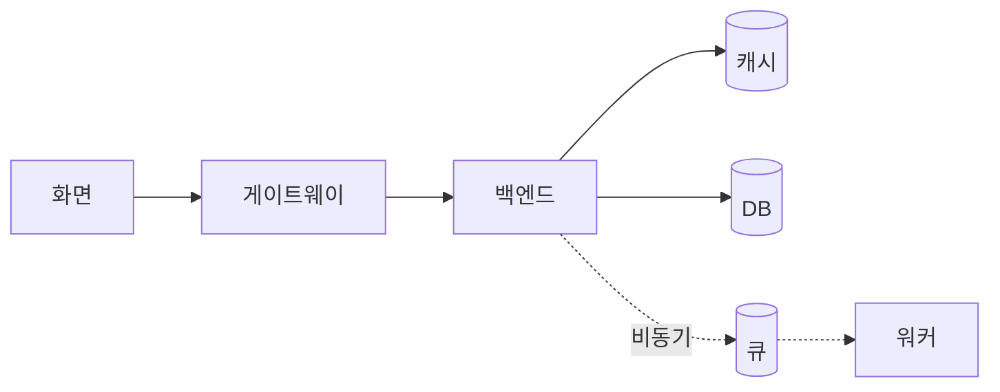

# 설계도 화면

위쪽 **설계도 / 설정**에서 설계도를 고르면 나오는 화면입니다.

```
┌──────────────────────────────────────────────────────────────┐
│ 파일 · 저장 · 설계서 PDF        [설계도 | 설정]      노드 추가 │
├───────────────────────────────────────────┬──────────────────┤
│                                           │ 선택한 것        │
│   캔버스                                   │ 전체 결과        │
│   화면 → 게이트웨이 → 서버 → 큐 → DB        │ 최선 조합        │
│   (카드: 판정 색 · 사용률 막대)              │                  │
│                                           │  오른쪽 결과 패널  │
├───────────────────────────────────────────┤                  │
│ 아래 그래프: 핵심 숫자 · 하루 사용률 · 성장   │                  │
└───────────────────────────────────────────┴──────────────────┘
```

위쪽 줄의 패널 단추로 아래·오른쪽을 접고, **다이어그램만**으로 둘 다 접습니다.

## 캔버스



| 동작 | 결과 |
|---|---|
| 블록을 놓고 끌어서 잇기 | 연결선마다 동기/비동기, 호출 비율, 읽기·쓰기, 왕복 지연 |
| 카드 누르기 | 그 블록 안(세부 구성)으로 들어가고 오른쪽에 선택 |
| 자동 배치 · 3D 보기 | 다시 늘어놓기 · 레이어를 입체로 |
| Esc · 오른쪽 클릭 | 세부 구성에서 나오기 |

**세부 구성**

| 블록 | 안에서 하는 일 |
|---|---|
| 서버 | 대수와 분배 방식 |
| DB · 캐시 · 분석 | 테이블·컬럼·인덱스, SQLite로 직접 실험 |
| 부품 | 주 항목·보조 항목을 끌어 놓아 바꿈 |
| 화면 | 와이어프레임: 기기별 화면 그리기, HTML 가져오기, PNG 저장. 버튼의 API 호출이 부하 계산으로 이어짐 |

## 아래 그래프

핵심 숫자(서버 트래픽 · DAU · 창 안 접속 · 피크/이벤트 피크 RPS · 하루 송신), 하루 서버 사용률, 사용자 유입, 페르소나 단계, 한계에 닿는 곳.

## 오른쪽 결과 패널

### 선택한 것

| 칸 | 내용 |
|---|---|
| ★ 판정 근거 | 항목마다 판정과 이유, 통과하는 대안 |
| 📊 계산 결과 | 부하, 대수, 사용률, p99, 가용성, DB 연결 수, 한계 사용자, 파이프라인 줄 |
| 목표로 찾기 | 목표(가용성·비용 등)에 좋은 항목을 바로 적용 |
| 사양·운영 | vCPU·메모리, 이중화·최소 대수, 처리 시간, 캐시 적중률, DB 연결 풀, 큐 파티션·허용 지연, 자동 확장, 배치 |
| 장애 대비 | 존 수, 다른 리전 복사본, 백업 → 결과 줄 |
| 데이터 위치·개인정보 | 리전, 개인정보 속성 → 확인할 조문 |
| 직접 넣는 값 | 엔진이 계산하지 않는 값·실측값 |

### 전체 결과
규모 · 페르소나별 트래픽 · 테이블 크기 · 확장 한계 · 경로(가용성·리전 장애) · 월 비용 · 구조 규칙 · 확인할 조문 · 판정 요약

### 최선 조합


계산 방식은 [계산 방식](model.md)에 있습니다.
