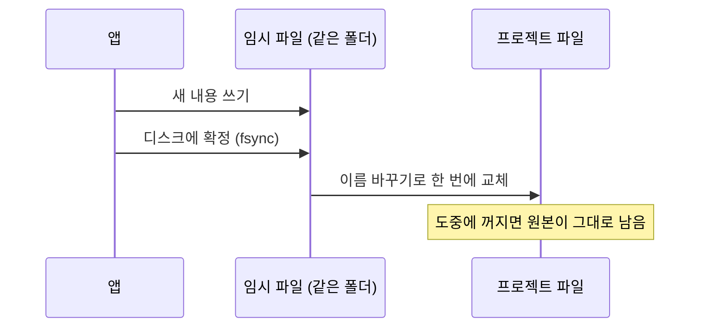
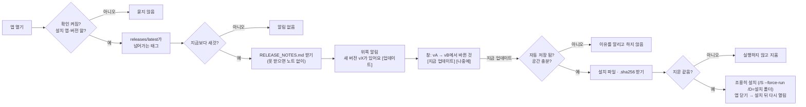
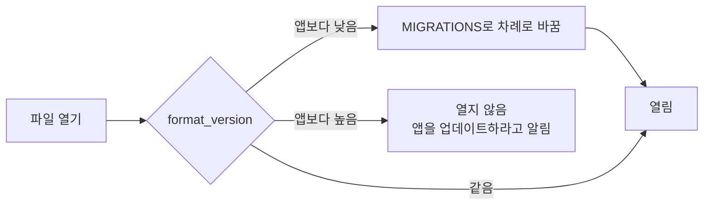

# 저장 · 불러오기 · 설계서

## 파일 메뉴

| 메뉴 | 하는 일 |
|---|---|
| 예시 불러오기 | 예시 프로젝트(`examples/*.json`)를 엶 |
| 열기 / 파일로 내보내기 | 프로젝트를 JSON으로 열고 저장 |
| 코드 분석 불러오기 | `tools/analyze_py.py`가 파이썬 코드를 분석해 만든 JSON을 합침 (서비스·워커 후보). 상대 import(`from .x`)는 프로젝트 안 모듈로 잇고, 문법·인코딩 오류 파일은 건너뛰고 알림. 합칠 때 순환을 만드는 연결선은 넣지 않고 개수를 알림 |
| 저장 기록 | 저장한 시점 목록. 시점으로 되돌리거나 자동 저장 간격을 바꿈 |
| 인터페이스 명세 내보내기 | 연결선의 명세를 표준 파일로: REST → `openapi-노드.json` (OpenAPI 3.0, 인증·에러 응답 포함), gRPC → `노드.proto`, 메시지 → `asyncapi.json` (AsyncAPI 3.0), 받는 노드가 FastAPI면 `노드_fastapi.py` (pydantic 모델 + 엔드포인트 뼈대, 각 함수는 501, 에러·인증 실패·요청 검증 실패를 모두 problem+json으로 돌려줌. 띄우면 `/docs`가 내보낸 OpenAPI와 같음). 응답 필드가 없는 인터페이스는 204(본문 없음)로 적습니다. 파일·전문은 `layout-보내는-받는-ID.csv` (장 형식·인코딩·레코드 길이(줄바꿈 포함)·데이터 길이(줄바꿈 제외), 필드 순서·길이·시작·끝·맞춤·채움. 길이가 빠진 필드부터는 위치를 비움). 파일 이름의 영문·숫자·_ 밖 글자는 `_`로 바뀌고 숫자로 시작하면 앞에 `N`이 붙습니다. 이렇게 만든 이름이 겹치면(`schema-…sql`도 같음) 뒤에 `-2`, `-3`이 붙습니다. 데스크톱 앱은 폴더를 골라 한 번에(같은 이름 파일이 있으면 덮어쓸지 한 번 물음), 브라우저는 파일마다 내려받기 |
| 스키마(DDL)·데이터 사전 내보내기 | DB 노드마다 `schema-노드.sql` (CREATE TABLE·INDEX, NOT NULL·DEFAULT·PK·코드 값 CHECK, 주석). 방언은 주 항목으로: PostgreSQL(Neon·Supabase·CockroachDB 포함, COMMENT ON) · MySQL 8.0.13 이상(줄 안 COMMENT, TEXT·JSON 기본값은 괄호 식, 키로 쓰는 길이 없는 문자열은 VARCHAR(255), 255바이트가 넘는 고정장은 VARCHAR, 16383자가 넘는 문자열은 MEDIUMTEXT, 시각 글자의 `Z`·`+09`는 `+00:00`·`+09:00`(시간대가 든 값은 MySQL 8.0.19 이상), BINARY(16) uuid 값은 `UUID_TO_BIN`) · SQLite(libSQL 포함, `--` 주석, 정수로 저장하는 시각은 epoch 밀리초·날짜는 1970-01-01부터 날 수, 실수는 율리우스일. 날짜 글자 기본값도 이 숫자로 바꿔 넣음) · 그 밖의 SQL DB는 표준에 가까운 형태(열 저장 분석 DB는 CREATE INDEX 없음). MongoDB·DynamoDB와 캐시 노드는 DDL 없이 데이터 사전에만. 테이블 명세 경고(기본값·코드 값 타입, 인덱스 이름 겹침 등)는 파일 머리에 `-- 주의:` 줄로 들어갑니다. 그리고 `data-dictionary.csv` (컬럼마다 논리명·DB 타입·필수·기본값·PK·도메인·코드 값·개인정보·쓰는·읽는 기능, 엑셀용 BOM. `= + - @`로 시작하는 글자 칸은 엑셀이 수식으로 읽지 않게 앞에 `'`를 붙임). 파티션·보관 기간은 DDL에 넣지 않음 |

## 저장

| 종류 | 언제 | 남기는 수 |
|---|---|---|
| 직접 저장 (Ctrl+S) | 누를 때 | 시점 20개 |
| 자동 저장 | 고칠 때마다 최신 시점을 덮어쓰고, 간격(기본 10분)마다 새 시점 | 시점 10개 |

- 강제로 닫혀도 다시 열면 복구를 제안합니다. 데스크톱 앱은 프로젝트 폴더에도 시점 파일을 남깁니다.
- 브라우저 저장소가 꽉 차면 오래된 시점부터 지우고, 그래도 못 쓰면 알려 줍니다.

데스크톱 앱은 **원자적으로** 저장합니다. 저장 중에 앱이 꺼져도 원본은 예전 내용 그대로입니다.



## 새 버전 알림

설치 앱은 열 때 새 버전을 한 번 확인합니다(기본 켜짐, **설정 › 앱 › 앱을 열 때 새 버전 확인**으로 끄고 켬).



| 묻지 않는 경우 | 개발 실행, 버전을 모름(1.1.0-local처럼 숫자가 아닌 조각), 태그 없이 만든 시험 빌드(0.0.0), 설정에서 끈 경우 |
|---|---|
| GitHub에 보내는 요청 | 최신 릴리스 주소(HEAD) 하나, 새 버전이면 노트 하나. **지금 업데이트**를 누르면 설치 파일·지문 |
| 버전 비교 | 점으로 나눈 숫자 튜플(1.10 > 1.9). 태그는 `v` + 영문·숫자·`.+-`만 받음 |
| 업데이트 안전 장치 | 지문(.sha256 첫 낱말)이 맞을 때만 실행, 다르면 지움. 설치 프로그램이 2초 안에 실패 코드로 끝나면 앱을 닫지 않고 알림 |

릴리스 노트는 글자로만 보여 줍니다(`##`·`###` 머리는 ■). 인터넷이 안 되면 조용히 넘어갑니다. 코드 서명이 없어서 처음 설치할 때 Windows 경고가 나올 수 있습니다.

## 릴리스 만들기

1. [CHANGELOG.md](../CHANGELOG.md)에 `## v버전` 절을 **추가 · 개선 · 삭제** 세 칸으로 씁니다(바뀐 것이 없으면 "- 없음").
2. `package.json`의 `version`을 같은 값으로 올리고 `v버전` 태그를 push합니다.
3. GitHub Actions가 시험·빌드 뒤 설치 파일, `.sha256`, `RELEASE_NOTES.md`(CHANGELOG에서 그 절만 뽑음)를 올리고, 릴리스 설명 첫 줄에 지문을 적습니다. 절이 없으면 릴리스하지 않습니다.

## 파일 형식 버전

저장 파일에는 `format_version`(지금 2)이 들어갑니다. 버전이 없는 옛 파일은 1로 봅니다. 2는 v1.2.1에서 올렸습니다. v1.2.0에서 더한 장 형식·데이터 사전·파일·전문·테이블 연결을 옛 앱이 지우지 않게 하려는 것입니다(1 → 2는 바꾸는 값 없음). 필드를 더할 때도 버전을 올립니다: 옛 앱이 열고 저장하면 모르는 필드가 사라지기 때문입니다.



새 버전 파일을 열지 않는 이유: 이 앱이 모르는 값은 버려진 채로 다시 저장되어 사라지기 때문입니다.

같거나 낮은 버전 파일은 모양(필드 이름·형식)만 맞으면 엽니다. 없는 컬럼을 가리키는 기본 키처럼 내용이 서로 맞지 않으면 열기는 되고, 결과 자리에 오류 배너가 떠서 화면에서 고칠 수 있습니다(명령줄은 이런 파일을 거부). 선택 숫자 칸이 범위 밖(예: 비율 칸에 80)이면 그 칸을 빼고(기본값이 있으면 기본값) 열고, 비어 있는 필수 이름 칸은 "이름 없음"으로 채워 열고 알립니다. 화면에서는 범위 밖 숫자를 넣으면 그 편집을 적용하지 않고 알립니다. 양 끝 중 없는 노드가 있는 연결선과 페르소나의 없는 행동 빈도는 화면에서 고칠 수 없어서 열 때 빼고 알립니다. 다른 파일을 연 뒤 되돌리기로 그 전으로 돌아가면, 다음 저장은 파일 이름을 다시 묻습니다(다른 파일을 덮어쓰지 않게).

## 설계서 PDF

위쪽 **설계서 PDF**를 누르면 A4 설계서가 열립니다.

| 절 | 내용 |
|---|---|
| 1~4 | 요약, 구동 방식, 규모 가정, 구조도 |
| 5 | 화면 설계 · API 호출 · 인터페이스 명세 (연결선마다 방식·경로·필드·크기·피크 호출, 파일·전문은 장 형식·인코딩) |
| 6 | 데이터 명세 (기능별 테이블, 테이블마다 데이터 사전) |
| 7 | 노드별 선택과 판정 근거 (계산 결과·파이프라인·장애 시나리오 카드) |
| 8~10 | 확장 한계·지연·월 비용, 최선 조합, 가용성·성장 |
| 11~14 | 확인할 조문, 미해결 목록, 적용한 설정, 카탈로그 출처 |

## 단축키

| 키 | 동작 |
|---|---|
| Ctrl+S | 저장 |
| Ctrl+Shift+S | 파일로 내보내기 (JSON) |
| Ctrl+O | 파일 열기 |
| Ctrl+Z / Ctrl+Y | 되돌리기 / 다시 하기 |
| Ctrl+F | 노드·항목·테이블·컬럼 찾기 |
| Ctrl+C / Ctrl+V | 노드 복사 / 붙여넣기 |
| Esc | 설계서 닫기 → 세부 구성에서 나오기 → 선택 해제 |

## 명령줄

```bash
npm run judge -- examples/global-commerce.json
```

같은 계산을 글로 출력합니다: 규모(테이블별 하루 행 포함), 노드별 결과, 데이터 파이프라인, 인터페이스 명세 점검(방식·장 형식·레코드 길이), 기능별 테이블, 장애 시나리오, 동기 경로, 월 비용, 성장, 판정, 구조 규칙, 확인할 조문. 파일을 내보내지는 않습니다(내보내기는 앱의 파일 메뉴).

`tools/fetch_prices.py`는 클라우드 공식 가격 API에서 한국·일본 리전 가격을 받아 `data/prices/` 형식으로 저장합니다.
