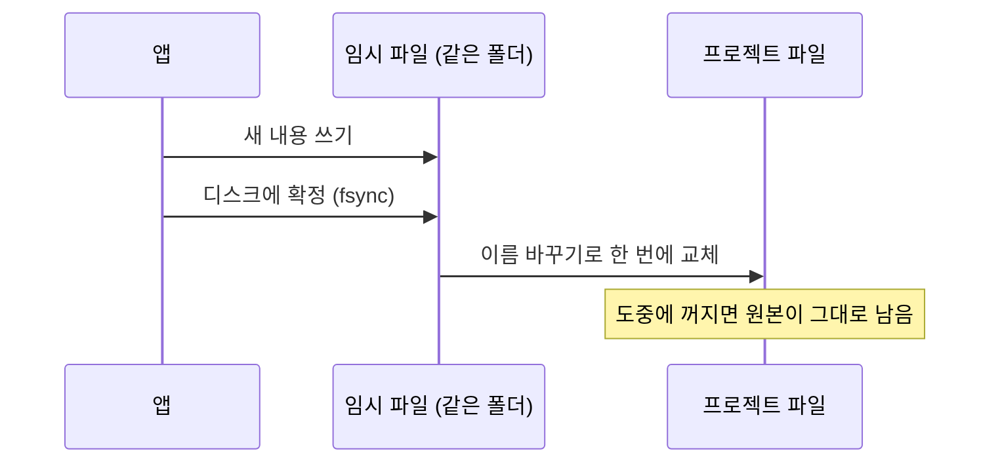
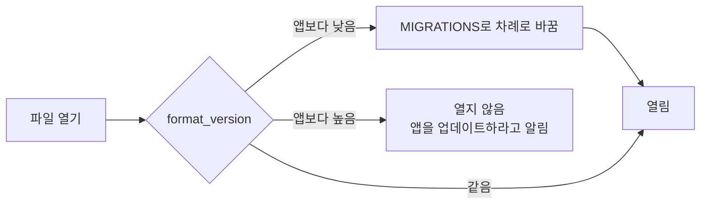

# 저장 · 불러오기 · 설계서

## 파일 메뉴

| 메뉴 | 하는 일 |
|---|---|
| 예시 불러오기 | 예시 프로젝트(`examples/*.json`)를 엶 |
| 열기 / 파일로 내보내기 | 프로젝트를 JSON으로 열고 저장 |
| 코드 분석 불러오기 | `tools/analyze_py.py`가 파이썬 코드를 분석해 만든 JSON을 합침 (서비스·워커 후보) |
| 저장 기록 | 저장한 시점 목록. 시점으로 되돌리거나 자동 저장 간격을 바꿈 |
| 인터페이스 명세 내보내기 | 연결선의 명세를 표준 파일로: REST → `openapi-노드.json` (OpenAPI 3.0, 인증·에러 응답 포함), gRPC → `노드.proto`, 메시지 → `asyncapi.json` (AsyncAPI 3.0), 받는 노드가 FastAPI면 `노드_fastapi.py` (pydantic 모델 + 엔드포인트 뼈대, 각 함수는 501). 데스크톱 앱은 폴더를 골라 한 번에, 브라우저는 파일마다 내려받기 |

## 저장

| 종류 | 언제 | 남기는 수 |
|---|---|---|
| 직접 저장 (Ctrl+S) | 누를 때 | 시점 20개 |
| 자동 저장 | 고칠 때마다 최신 시점을 덮어쓰고, 간격(기본 10분)마다 새 시점 | 시점 10개 |

- 강제로 닫혀도 다시 열면 복구를 제안합니다. 데스크톱 앱은 프로젝트 폴더에도 시점 파일을 남깁니다.
- 브라우저 저장소가 꽉 차면 오래된 시점부터 지우고, 그래도 못 쓰면 알려 줍니다.

데스크톱 앱은 **원자적으로** 저장합니다. 저장 중에 앱이 꺼져도 원본은 예전 내용 그대로입니다.



## 파일 형식 버전

저장 파일에는 `format_version`(지금 1)이 들어갑니다. 버전이 없는 옛 파일은 1로 봅니다.



새 버전 파일을 열지 않는 이유: 이 앱이 모르는 값은 버려진 채로 다시 저장되어 사라지기 때문입니다.

## 설계서 PDF

위쪽 **설계서 PDF**를 누르면 A4 설계서가 열립니다.

| 절 | 내용 |
|---|---|
| 1~4 | 요약, 구동 방식, 규모 가정, 구조도 |
| 5 | 화면 설계 · API 호출 · 인터페이스 명세 (연결선마다 방식·경로·필드·크기·피크 호출) |
| 6 | 노드별 선택과 판정 근거 (계산 결과·파이프라인·장애 시나리오 카드) |
| 7~9 | 확장 한계·지연·월 비용, 최선 조합, 가용성·성장 |
| 10~13 | 확인할 조문, 미해결 목록, 적용한 설정, 카탈로그 출처 |

## 단축키

| 키 | 동작 |
|---|---|
| Ctrl+S | 저장 |
| Ctrl+Shift+S | 파일로 내보내기 (JSON) |
| Ctrl+O | 파일 열기 |
| Ctrl+Z / Ctrl+Y | 되돌리기 / 다시 하기 |
| Ctrl+F | 노드·항목·테이블·컬럼 찾기 |
| Ctrl+C / Ctrl+V | 노드 복사 / 붙여넣기 |
| Esc | 설계서 닫기 → 세부 구성에서 나오기 → 선택 해제 |

## 명령줄

```bash
npm run judge -- examples/global-commerce.json
```

같은 계산을 글로 출력합니다: 판정, 노드별 결과, 데이터 파이프라인, 장애 시나리오, 경로, 월 비용, 성장.

`tools/fetch_prices.py`는 클라우드 공식 가격 API에서 한국·일본 리전 가격을 받아 `data/prices/` 형식으로 저장합니다.
