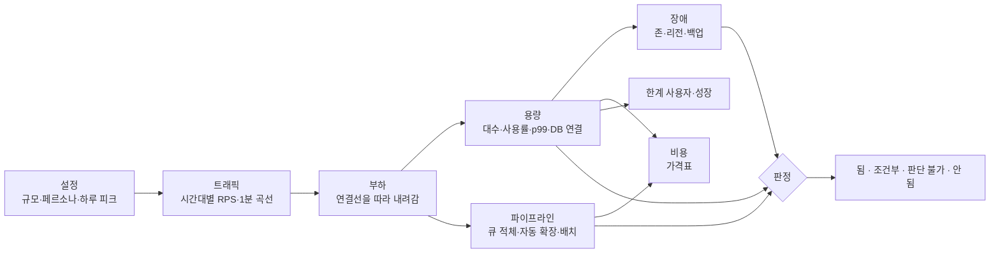
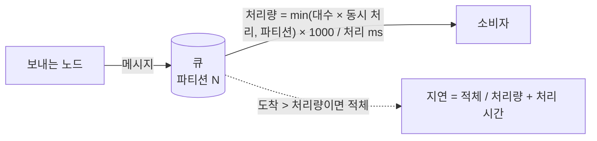
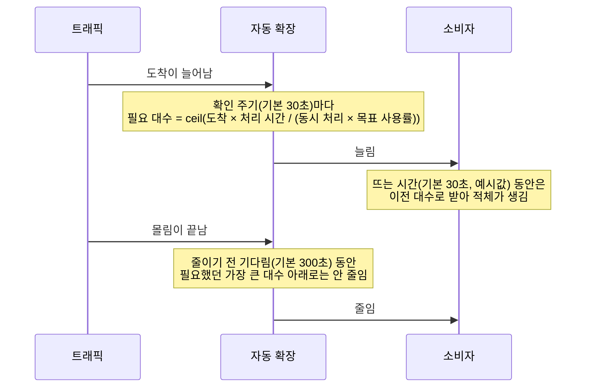
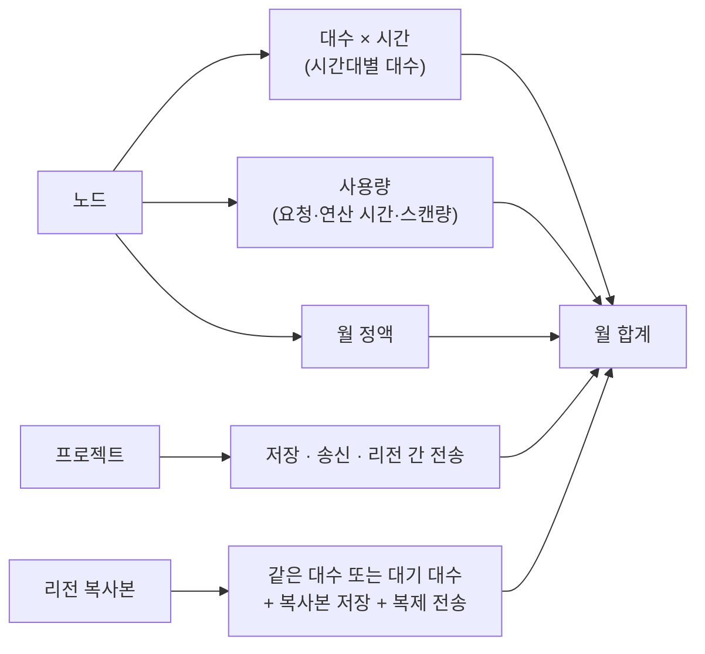
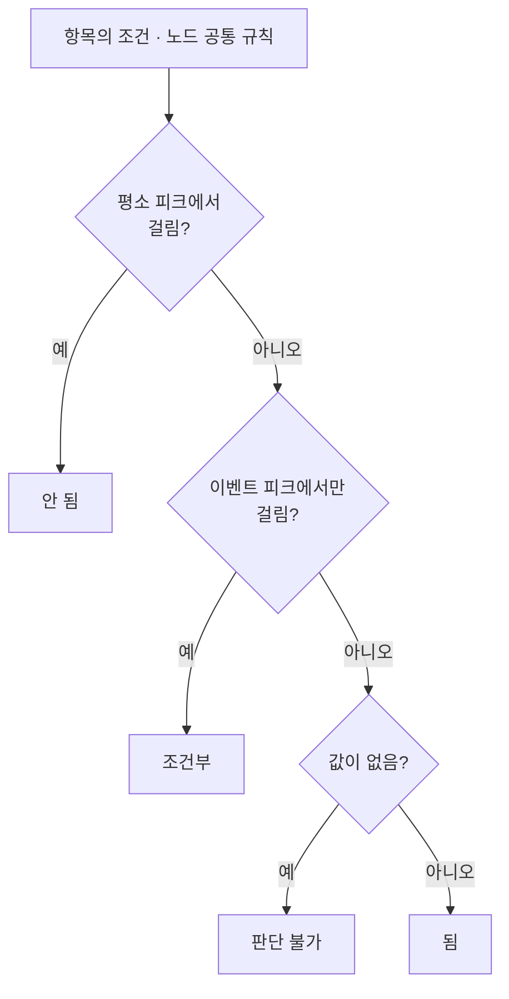

# 계산 방식

모든 숫자는 계산식과 입력값을 함께 남깁니다. 화면에서 값에 마우스를 올리면 어떻게 나왔는지 보입니다. **예시값**이라고 적힌 기본값은 형식 확인용이니 잰 값으로 바꾸세요.

## 계산 순서



## 트래픽

| 무엇 | 어떻게 |
|---|---|
| 하루 트래픽 | 페르소나마다 접속 시각·횟수·시간을 무작위로 뽑아 하루를 만듦 (시드가 같으면 결과도 같음) |
| 이벤트 피크 | 평소 피크 × 이벤트 배수 |
| 데이터 주고받기 | 폴링 주기·모아 보내기가 요청 수를 바꿈 |
| 1분 곡선 | 같은 가정의 평균 곡선. 하루 양은 무작위 하루와 같게 맞춤 → 아래 그래프·큐 소비자에 씀 |
| 일시적 급증 (켰을 때) | 무작위 시각(시드 고정)에 1 → 높이 → 1로 오르내림. 겹쳐도 높이(최대 1.5배)를 넘지 않음 |

```
부하 ▲      급증(높이 1.2배, 10분)
     │        ╱╲
     │   ____╱  ╲____       ← 평소 곡선
     │  ╱              ╲
     └──────────────────────▶ 시각
```

> 급증은 지금 1분 곡선(그래프·큐 소비자)에만 들어갑니다. 서버 대수를 정하는 피크 RPS는 바꾸지 않습니다.

## 용량 · 지연 · 한계

| 값 | 계산 |
|---|---|
| 연결선 부하 | 보내는 노드 부하 × 호출 비율 (읽기·쓰기 구분, 캐시가 앞에 있으면 DB 읽기 × (1 − 적중률), 적중률 기본 0.8 **예시값**). 화면 와이어프레임 호출 → 인터페이스 명세 → 호출 비율 순으로 먼저 있는 것을 씀 |
| 인터페이스 명세 | 인터페이스마다 (모든·읽기·쓰기) 요청 × 횟수. 받는 쪽 읽기·쓰기는 명세의 구분대로. 파일·전문은 쓰기, 크기는 레코드 길이(고정장 = Σ 필드 길이 + 줄바꿈, 가변장 = Σ 값 + 구분자 + 줄바꿈) |
| 테이블 행 크기 | Σ 값 크기 + 저장 시스템의 행·컬럼 오버헤드. 고정장 테이블은 PostgreSQL·MySQL에서 문자열·바이너리를 최대 길이로 셈 (SQLite는 실제 길이) |
| 필요 대수 | ceil(부하 / (대당 처리량 × 목표 사용률)), 최소·최대 대수로 자름 |
| 대당 처리량 | 업계 기준값 → 사양(vCPU·메모리)으로 보정 → 실측이 있으면 실측 |
| 주 서버 1대 DB | 쓰기는 주 서버가 모두, 읽기 복제본이 있으면 읽기만 나눔 |
| DB 연결 수 | Σ 부르는 노드 대수 × 연결 풀(기본 10). 연결 풀러가 있으면 풀러 크기까지 |
| p99 | 대기열 모형(Erlang C). 경로 p99는 동기 경로를 따라 더함 |
| 한계 사용자 | 이벤트 피크에서 "안 됨"이 되기 직전의 사용자 수. 가장 먼저 닿는 노드 = 첫 병목 |

## 데이터 파이프라인



| 소비자 | 계산 |
|---|---|
| 고정 대수 | 하루를 30초 칸으로 돌림. 도착은 설정의 계산 단위(1·5·15·60분, 기본 60분)마다 평균 |
| 자동 확장 (KEDA처럼) | 1분 곡선으로 하루를 30초 칸으로 돌림. 아래 그림처럼 대수를 바꿈 |
| 주기 배치 | 1회 실행 = 주기 동안 들어온 양 / 처리량 (실행 창 안에 끝나야 함), 반영까지 최대 = 주기 + 1회 실행 |

자동 확장 한 번의 흐름:



비용은 시간대별 평균 대수, DB 연결 수는 가장 많을 때 대수로 셉니다.

## 장애

| 장애 | 멈추는 것 | 남는 사용률·시간 | 기본값 (**예시값**) |
|---|---|---|---|
| 존 하나 | 존이 1개뿐인 노드 | 남은 서버 사용률 = 지금 × 대수 / 남은 대수 (잃는 대수 = ceil(대수 / 존 수)) | 주 서버 DB 넘기기 60초 |
| 리전 하나 | 다른 리전 복사본이 없는 노드 → 그 노드에 동기로 닿는 화면 | 대기 복사본으로 넘긴 직후 사용률 = 지금 × 대수 / 대기 대수 | 넘기기: 같이 받기 60초, 대기 900초 |
| 데이터 손상 | — | RPO = 백업 주기·시점 복구·복제 지연 중 짧은 것<br/>RTO = 새 서버 준비 + 데이터 크기 / 되살리는 속도 | 시점 복구 5분, 복제 지연 5초, 준비 10분, 100MB/초 |

## 비용



리전이 다른 연결선의 전송량은 인터페이스 명세가 있으면 Σ 월 호출 × (요청 + 응답 크기), 없으면 사용자 응답 평균 크기로 어림합니다. 가격이 없는 상품·리전은 0원으로 채우지 않고 **가격 없음**으로 알립니다.

## 판정



| 노드 공통 규칙 | 평소 | 이벤트에서만 |
|---|---|---|
| 사용률 100% 초과 | 안 됨 | 안 됨 |
| 큐 지연 > 허용, 배치 실행 > 실행 창 | 안 됨 | 조건부 |
| 장애 목표: 화면이 멈춤 / 반영만 늦음 | 안 됨 / 조건부 | |
| 장애 목표: 장애 직후 넘침 | 조건부 (자동 확장이 채움) | |
| 장애 목표: RTO·RPO 초과 | 안 됨 | |

판정 순위: 됨 < 조건부 < 판단 불가 < 안 됨

## 성장 · 법령

- **성장:** 월 성장률 또는 유입 모형으로 달마다 사용자 수를 구합니다. 노드마다 한계에 닿는 달과 준비를 시작할 달, 달별 비용, 파티션 없는 테이블이 메모리를 넘는 달을 보여 줍니다.
- **법령:** 개인정보를 두는 노드의 리전·데이터 주체 나라로 한국·일본 법령의 "확인할 조문"을 표시합니다. 법률 검토를 대신하지 않습니다.
