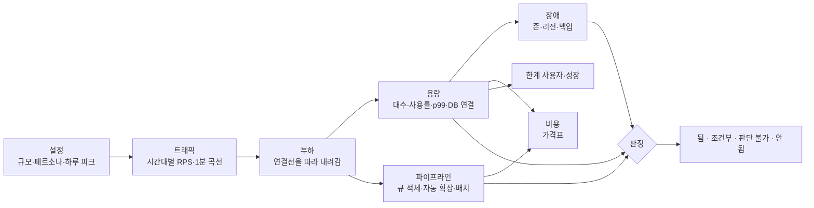
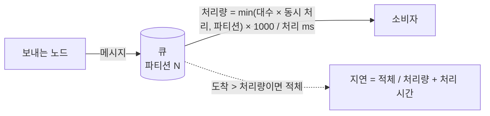
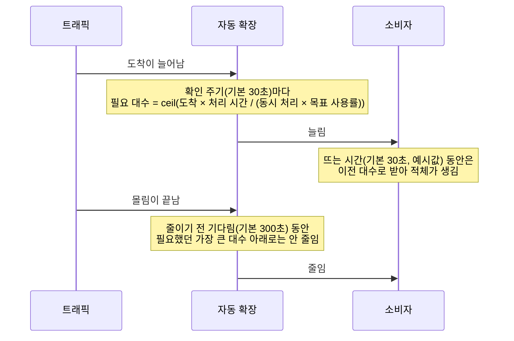
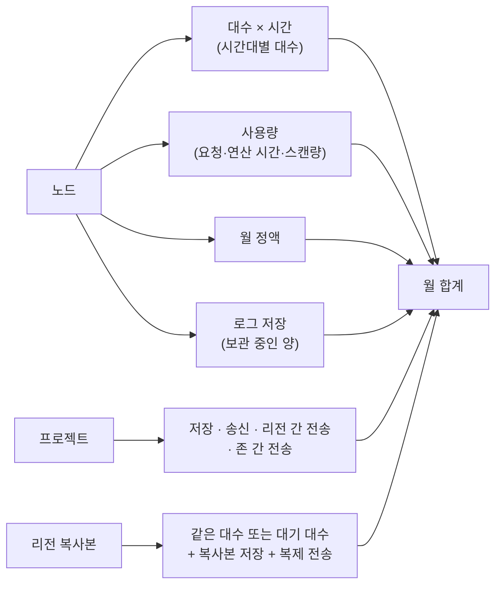
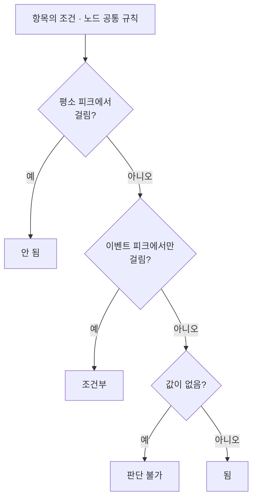

# 계산 방식

모든 숫자는 계산식과 입력값을 함께 남깁니다. 화면에서 값에 마우스를 올리면 어떻게 나왔는지 보입니다. **예시값**이라고 적힌 기본값은 형식 확인용이니 잰 값으로 바꾸세요.

## 계산 순서



## 트래픽

| 무엇 | 어떻게 |
|---|---|
| 하루 트래픽 | 페르소나마다 접속 시각·횟수·시간을 무작위로 뽑아 하루를 만듦 (시드가 같으면 결과도 같음) |
| 이벤트 피크 | 평소 피크 × 이벤트 배수 |
| 데이터 주고받기 | 폴링 주기·모아 보내기가 요청 수를 바꿈 |
| 1분 곡선 | 같은 가정의 평균 곡선. 하루 양은 무작위 하루와 같게 맞춤 → 아래 그래프·큐 소비자·주기 배치에 씀 |
| 일시적 급증 (켰을 때) | 무작위 시각(시드 고정)에 1 → 높이 → 1로 오르내림. 겹쳐도 높이(최대 1.5배)를 넘지 않음 |

```
부하 ▲      급증(높이 1.2배, 10분)
     │        ╱╲
     │   ____╱  ╲____       ← 평소 곡선
     │  ╱              ╲
     └──────────────────────▶ 시각
```

> 급증은 1분 곡선(그래프·큐 소비자·주기 배치 1회 양·자동 확장 API 서버)에 들어갑니다. 필요 대수를 정하는 피크 RPS는 바꾸지 않습니다.
> 자동 확장을 켠 API 서버(backend·gateway, 주 서버 1대 DB가 아닌 주 항목에 `autoscale`이 있을 때)는 1분 곡선(급증 포함)으로 큐 소비자와 같은 하루 시뮬레이션을 돌려, 새 서버가 뜨기 전 도착이 떠 있는 대수의 처리량을 넘는 시간(분)과 가장 큰 사용률을 판정합니다. 1건 처리 시간 = 1000 / 대당 처리량, 최소 = max(최소 대수, 이중화), 최대 = `autoscale.max` 없으면 항목의 최대 대수(`autoscale.max`가 커도 항목의 최대 대수를 넘지 않음). 비용도 이 시뮬레이션의 시간대별 대수를 씁니다.

## 용량 · 지연 · 한계

| 값 | 계산 |
|---|---|
| 연결선 부하 | 보내는 노드 부하 × 호출 비율 (읽기·쓰기 구분, 캐시가 앞에 있으면 DB 읽기 × (1 − 적중률), 적중률 기본 0.8 **예시값**). 화면 와이어프레임 호출 → 인터페이스 명세 → 호출 비율 순으로 먼저 있는 것을 씀 |
| 인터페이스 명세 | 인터페이스마다 (모든·읽기·쓰기) 요청 × 횟수. 받는 쪽 읽기·쓰기는 명세의 구분대로. 파일·전문은 쓰기, 크기는 레코드 길이(고정장 = Σ 필드 길이 + 줄바꿈, 가변장 = Σ 값 + 구분자 + 줄바꿈). 고정장 길이가 빠진 필드는 형식별 **예시** 크기로 어림(고정장은 평균 크기를 쓰지 않음). 가변장 문자열은 평균 크기가 없으면 32바이트로 보고 인코딩(EUC-KR·UTF-8)은 크기에 넣지 않음 |
| 테이블 행 크기 | Σ 값 크기 + 저장 시스템의 행·컬럼 오버헤드. 고정장 테이블은 PostgreSQL·MySQL에서 문자열을 최대 길이로 셈 (SQLite는 실제 길이). 바이너리는 어디서나 실제 길이로 세서 MySQL BINARY(n)은 조금 적게 나올 수 있음 |
| 필요 대수 | ceil(부하 / (대당 처리량 × 목표 사용률)), 최소·최대 대수로 자름 |
| 대당 처리량 | 업계 기준값 → 사양(vCPU·메모리)으로 보정 → 실측이 있으면 실측. 처리 시간(동시 처리 수·평균 처리 ms)을 넣으면 min(그 값, 동시 처리 수 × 1000 / 평균 처리 ms) — p99와 같은 한계 |
| 주 서버 1대 DB | 쓰기는 주 서버가 모두, 읽기 복제본이 있으면 읽기만 나눔 |
| DB 연결 수 | Σ 부르는 노드 대수 × 연결 풀(기본 10). 연결 풀러가 있으면 풀러 크기까지 |
| 대역폭·동시 연결 | 진입 서버 노드(화면에서 오는 연결선이 있는 gateway·backend)만. 대역폭은 노드 전체 응답(NIC가 다 실어 나름) = 그 노드 부하 × 평균 응답 크기(하루 송신 / 하루 요청) × 8 / 1000 Mbps, 연결은 화면에서 직접 오는 몫 = 피크 동시 접속 × 화면에서 그 노드로 직접 오는 흐름 / 진입 서버 노드 직접 흐름 합(다른 진입 서버가 넘긴 부하는 세지 않음). 한도 = 대당 한도(노드 `net.max_mbps`·`net.max_connections`, 비면 주 항목 기준값 `thresholds.mbps`·`thresholds.client_connections` — 게이트웨이 6종 1,000 Mbps·10,000 연결 **예시값**) × 그 피크의 대수. 대수는 RPS·대역폭·연결 중 가장 많이 필요한 것(같은 목표 사용률, 사용률 표시는 RPS 기준; 자동 확장 API 서버의 하루 시뮬레이션은 RPS 기준)이라 최대 대수에 막혔을 때만 넘음. 한도가 없으면 비교하지 않음. 부하에 비례하므로 한계 사용자 탐색에도 넣음 |
| p99 | 대기열 모형(Erlang C, 서버 수 × 동시 처리 수가 1000을 넘으면 Halfin–Whitt 근사). 경로 p99는 동기 경로를 따라 더함. 경로가 500개를 넘으면 앞쪽 500개만 계산하고 알림 |
| 한계 사용자 | 이벤트 피크에서 "안 됨"이 되기 직전의 사용자 수. 가장 먼저 닿는 노드 = 첫 병목. 자동 확장 넘침은 한계 탐색에 넣지 않음(사용자 수에 단조롭지 않음) |

## 데이터 파이프라인



| 소비자 | 계산 |
|---|---|
| 고정 대수 | 하루를 30초 칸으로 돌림. 도착은 설정의 계산 단위(1·5·15·60분, 기본 60분)마다 평균 |
| 자동 확장 (KEDA처럼) | 1분 곡선으로 하루를 30초 칸으로 돌림. 아래 그림처럼 대수를 바꿈 |
| 주기 배치 | 1회 실행 = 하루 중 주기 길이 창에 들어온 가장 많은 양 / 처리량 (실행 창 안에 끝나야 함; 주기가 하루 이상이면 하루 양 × 주기 / 1440), 반영까지 최대 = 주기 + 1회 실행 |

자동 확장 한 번의 흐름:



비용은 시간대별 평균 대수, DB 연결 수는 가장 많을 때 대수(API 자동 확장 노드는 피크 기준 대수)로 셉니다.

## 장애

늘 떠 있는 대수 = max(이중화, 최소 대수), 패턴의 최대 대수 이하. 가용성·단일 장애점·존 장애가 이 대수를 씁니다.

| 장애 | 멈추는 것 | 남는 사용률·시간 | 기본값 (**예시값**) |
|---|---|---|---|
| 존 하나 | 존이 1개뿐인 노드 | 남은 서버 사용률 = 지금 × 대수 / 남은 대수 (잃는 대수 = ceil(대수 / 존 수)). 대수 = max(계산 대수, 늘 떠 있는 대수) | 주 서버 DB 넘기기 60초 |
| 리전 하나 | 다른 리전 복사본이 없는 노드 → 그 노드에 동기로 닿는 화면 | 대기 복사본으로 넘긴 직후 사용률 = 지금 × 대수 / 대기 대수 | 넘기기: 같이 받기 60초, 대기 900초 |
| 캐시 장애 | 캐시 노드 전부 (읽기가 모두 DB로) | 캐시 적중률을 0으로 두고 부하를 다시 계산해 늘어나는 노드(보통 DB)의 사용률 = 캐시 없을 때 부하 / (대수 × 대당 처리량), 대수 그대로 (주 서버 1대 DB는 읽기 복제본이 있으면 max(쓰기 / 대당 처리량, 읽기 / (복제본 수 × 대당 처리량)), 없으면 부하 / 대당 처리량) | 적중률 0.8 → DB 읽기 5배 |
| 데이터 손상 | — | RPO = 백업 주기·시점 복구·복제 지연 중 짧은 것<br/>RTO = 새 서버 준비 + 데이터 크기 / 되살리는 속도 | 시점 복구 5분, 복제 지연 5초, 준비 10분, 100MB/초 |

## 비용

한 달 = 730시간(클라우드 가격표 기준). 하루 값은 × 730/24로 한 달로 바꿉니다. 월 중단 시간도 730시간 기준입니다.



연결선의 전송량은 인터페이스 명세가 있으면 Σ 월 호출 × (요청 + 응답 크기), 없으면 사용자 응답 평균 크기로 어림합니다. 리전이 다른 연결선은 이 전송량 전부를 **리전 간 전송**으로 셉니다.

| 줄 | 대상 | 수량 | 상품 (설정 › 비용 기준) |
|---|---|---|---|
| 존 간 전송 | 같은 리전의 서버 노드 사이 연결선(화면·외부·사용자 기기 제외, 양쪽 주 항목이 직접 운영 `provisioned`일 때만: SQS·DynamoDB 같은 리전 단위 관리형은 AZ 간 요금이 없고 Neon·Turso는 다른 업체 청구서), 두 노드 중 큰 존 수 z가 2 이상 | 전송량 × (1 − 1/z) GB. 단가는 양방향 합(AWS는 보내는 쪽 0.01 + 받는 쪽 0.01 = 0.02). 두 노드가 같은 존들에 고르게 퍼져 있고 호출이 무작위로 간다고 봄(존 친화 라우팅은 반영 안 함) | 존 간 전송 (단위 `gb_interzone`) |
| 로그 저장 | 요청당 로그(KB)를 넣은 서버 노드 | 보관 중인 양 = 하루 로그 GB(월 요청 × 요청당 KB ÷ 730/24일) × 보관 일수(없으면 30) GB·월. 수집 요금은 상품마다 달라 넣지 않음 | 로그 저장 (단위 `gb_month`) |

상품을 고르지 않으면 그 줄은 계산하지 않습니다. 가격이 없는 상품·리전은 0원으로 채우지 않고 **가격 없음**으로 알립니다.

## 판정



| 노드 공통 규칙 | 평소 | 이벤트에서만 |
|---|---|---|
| 사용률 100% 초과 | 안 됨 | 안 됨 |
| 큐 지연 > 허용, 배치 실행 > 실행 창 | 안 됨 | 조건부 |
| 자동 확장 API 서버가 넘친 시간 > 0분 (`autoscale_over_min`) | 안 됨 | 조건부 |
| 응답 대역폭·동시 연결 > 대수 × 대당 한도 (`peak_mbps > max_mbps_total`, `concurrent_conns > max_conns_total`) | 안 됨 | 조건부 |
| 장애 목표: 화면이 멈춤 / 반영만 늦음 | 안 됨 / 조건부 | |
| 장애 목표: 장애 직후 넘침 | 조건부 (자동 확장이 채움) | |
| 장애 목표: 캐시가 멈추면 사용률 100% 초과 (`cache_util`, 장애 목표가 있으면 견딜 장애 종류와 상관없이) | 조건부 | 조건부 |
| 장애 목표: RTO·RPO 초과 | 안 됨 | |

판정 순위: 됨 < 조건부 < 판단 불가 < 안 됨

## 네트워크 · 보안

노드·연결선의 보안 값과 구조로 점검합니다. 항목 판정과 따로 내며, 노드 판정 배지는 보안 ❌만 바꿉니다. 설계 값으로 하는 점검이라 실제 보안 그룹·인증서·침투 시험을 대신하지 않습니다.

| 점검 | 단계 |
|---|---|
| DB·캐시·큐·분석 노드가 인터넷 공개 | ❌ |
| 인터넷을 지나는 연결선이 암호화 없음 | ❌ |
| 개인정보 저장 노드의 저장 암호화 끔 | ❌ |
| 인터넷 공개 게이트웨이·백엔드에 WAF·속도 제한 끔 (token_bucket·kong 항목이나 한도 값 `rate_limit_rpm`이 있으면 속도 제한 충족) | ⚠️ |
| 속도 제한 한도(클라이언트당 분당 요청)가 정상 사용자의 바쁜 1분보다 낮음. 바쁜 1분 = 노드 이벤트 피크 RPS ÷ 이벤트 동시 접속자 × 60 × 3. 인터넷 공개 게이트웨이·백엔드만 대조하며, 트래픽 계산이 없거나 트래픽·동시 접속이 0이거나 바쁜 1분이 피크 전체 이상(사용자가 매우 적음)이면 대조하지 않음 | ⚠️ |
| 속도 제한 한도가 노드 이벤트 피크 전체(이벤트 피크 RPS × 60) 이상이라 효과가 적음 (위와 같은 범위만 대조) | ℹ️ |
| 화면(사용자 기기)에 비밀 보관 | ⚠️ |
| 고객 구분 컬럼(store_id·tenant_id 등)이 있는데 테넌트 분리 없음 | ⚠️ |
| 개인정보 노드, 또는 프로젝트에 개인정보 노드가 있을 때 인터넷 공개 게이트웨이·백엔드(개인정보를 읽고 쓰는 공개 API)에 감사 로그 끔 | ⚠️ |
| 감사 로그를 정할 노드에서 켬인데 보관 기간 `audit_retention_months`가 기준보다 짧음 (개인정보 안전성 확보조치 기준 12개월, 개인정보 노드(공개 API면 프로젝트의 개인정보 노드 중 하나)가 고유식별정보·민감정보이거나 사용자 5만 명 이상이면 24개월. 한국 고시 기준이라 데이터 주체가 정해졌는데 KR이 없으면 따지지 않음) | ⚠️ |
| 개인정보 컬럼(`personal`)의 보호 `protection`이 없음·미정 (테이블마다 한 줄 "노드.테이블", 컬럼 이름과 미정 수). 고유식별정보·민감정보 노드에서는 마스킹도 보호로 치지 않음(표시용이라 저장 암호화가 필요) | ⚠️ |
| 개인정보 컬럼이 있는 테이블에 보관 일수 `retention_days`를 직접 정하지 않음 (규모의 기본 보관 일수는 크기 가정이라 보지 않음) | ⚠️ |
| 인증 없는 쓰기 REST 인터페이스 | ⚠️ |
| DB·분석 노드(캐시·큐 제외)에 테이블이 있거나 개인정보 노드인데 백업 `backup`이 없음 (`sec_no_backup`). 다른 리전 복제본(`dr` active·standby)은 삭제·손상도 함께 복제되므로 백업으로 치지 않고 그 뜻을 문구에 붙임 | ⚠️ |
| 개인정보 노드의 백업 암호화 `backup.encrypted`를 끔 (`sec_backup_plain`) | ⚠️ |
| 백업 변조 방지(WORM·삭제 잠금) `backup.immutable`을 끔 (`sec_backup_mutable`) | ⚠️ |
| 백업 보관 일수 `backup.retention_days`가 max(7일, 백업 주기 2번 = 2 × `every_h` ÷ 24)보다 짧음 (`sec_backup_retention_short`, 비면 묻지 않음) | ⚠️ |
| 백업에서 되살려 본 적 없음 `backup.restore_tested` 끔 (`sec_restore_untested`, 훈련 날짜 `restore_tested_on`은 기록용) | ⚠️ |
| 마지막 복구 훈련 날짜가 오늘보다 365일 넘게 지남 ⚠️, 180일 넘게 지남 ℹ️ (`sec_restore_stale`, 훈련 했음인데 날짜가 비면 미정) | ⚠️ · ℹ️ |
| 비어 있는 보안 값 (노드·연결선마다 한 줄 "보안 값 미정", 감사 로그가 켬인데 보관 기간이 비면 "감사 로그 보관 기간"도. 백업이 있으면 비어 있는 "백업 암호화"(개인정보 노드만)·"백업 변조 방지"·"백업 보관 일수"·"복구 훈련"(했음인데 날짜가 비면 "복구 훈련 날짜")도. 컬럼 개인정보 표시만 있고 노드 개인정보 속성이 비면 "개인정보 속성(개인정보 컬럼 있음)"으로 미정 알림 — 법령·감사 로그 판정은 노드 속성 기준. 동기 연결선은 타임아웃 `timeout_ms`가 비면 암호화를 정했어도 "타임아웃" 미정 줄이 생김(재시도·브레이커는 비면 재시도 없음으로 봄) | ⚠️ |
| 타임아웃(동기 연결선만, 아래도 같음)이 받는 쪽과 그 뒤 동기 호출의 이벤트 피크 p99(받는 노드부터 동기 경로 끝까지 중 가장 큰 경로 p99, 경로가 없으면 노드 p99)보다 짧음 (`net_timeout_short`, 처리 시간을 넣은 노드만 대조) | ⚠️ |
| 타임아웃이 그 p99 이상이지만 1.5배 미만 (`net_timeout_tight`) | ℹ️ |
| 재시도 `retries` 1회 이상인데 타임아웃 없음 (`net_retry_no_timeout`) | ⚠️ |
| 재시도 폭풍: 받는 노드 이벤트 사용률 × (1 + 재시도) > 100% (`net_retry_storm`, 모든 요청이 실패해 재시도하는 최악만 보고 받는 노드 부하가 모두 이 선에서 온다고 봄. 브레이커가 켬이면 ℹ️) | ⚠️ |
| 재시도가 있는데 서킷 브레이커 `breaker`를 끔 (`net_no_breaker`, 비면 묻지 않음) | ℹ️ |
| 바깥 타임아웃보다 안쪽(받는 노드에서 나가는 동기 연결선 중 가장 긴) 재시도 포함 최대 대기 `timeout_ms × (1 + retries)`가 같거나 긺 (`net_timeout_chain`) | ⚠️ |
| 서로 다른 클라우드 사이 연결 / 같은 클라우드의 다른 리전 연결 | ℹ️ |
| 인증·인가(프로젝트 단위, 인터넷 공개 노드(게이트웨이·백엔드)나 화면이 바로 부르는 외부 서비스가 있을 때만): 인증 방식 미정 | ⚠️ |
| 인증 방식은 있는데 토큰 수명(JWT·OAuth2/OIDC·세션만)·MFA·권한 모델·관리자 분리·서비스 간 인증 중 빈 값 (한 줄 "인증·인가 값 미정"; 인증 없음이면 MFA·관리자 분리는 묻지 않음) | ⚠️ |
| 인증 없음인데 공개 노드에 bearer·API 키가 아닌 쓰기 REST 인터페이스(GET 아님) | ⚠️ |
| 인증 없음인데 공개 노드의 쓰기 REST 인터페이스는 모두 bearer·API 키 (둘 중 하나가 틀림) | ⚠️ |
| 토큰 수명이 김 (JWT·OAuth2/OIDC 1440분 = 하루 초과는 갱신 토큰이 있어도, 세션 10080분 = 7일 초과는 갱신 없을 때, API 키는 보지 않음) | ⚠️ |
| 개인정보 노드나 고객 구분 컬럼이 있는데 MFA 없음 | ⚠️ |
| 권한 모델 없음인데 개인정보 노드나 고객 구분 컬럼이 있음 | ⚠️ |
| 개인정보 노드나 고객 구분 컬럼이 있는데 관리자 기능을 따로 두지 않음 | ⚠️ |
| 서비스 간 인증 없음인데 서버 노드(화면·외부 서비스·저장 노드 제외)가 2개 이상 | ℹ️ |
| 웹 클라이언트 보안(프로젝트 단위, 위 인증·인가 문이 열리고 구동 방식이 웹·하이브리드일 때만): 출처 허용(CORS)·쿠키 SameSite·쿠키 HttpOnly·쿠키 Secure·CSRF 토큰·CSP·HSTS·토큰 보관이 모두 빔 (`sec_web_unset`, 문구에는 묻는 칸만 나열) | ⚠️ |
| 웹 클라이언트 보안 일부만 빔 (`sec_web_partial`, 한 줄). CSP는 늘 묻고, CORS·HSTS는 공개 gateway·backend가 있을 때만(화면 → 외부 서비스만 있으면 사업자가 정하므로 묻지 않고 판정하지 않음), 쿠키 SameSite·HttpOnly·Secure·CSRF 토큰은 쿠키 기반(인증 방식 세션 쿠키이거나 토큰 보관이 쿠키)일 때만, 토큰 보관은 토큰 기반(JWT·OAuth2/OIDC)일 때만 묻는다. 인증 방식이 비면 쿠키·토큰 칸은 묻지 않고 문구에 그렇게 안내 | ⚠️ |
| 쿠키 기반인데 CORS가 모든 출처(Origin 반사 + Allow-Credentials) (`sec_cors_any`) ⚠️, 토큰 기반인데 모든 출처 (`sec_cors_any_token`) ℹ️. 인증 방식이 비면 없음 | ⚠️ · ℹ️ |
| 인증 방식이 API 키인데 브라우저 앱 (`sec_api_key_in_browser`, 번들에 키가 드러남) | ⚠️ |
| 쿠키 기반인데 CSRF 토큰 없음이고 SameSite가 strict가 아님 (`sec_cookie_no_csrf`, lax이면 "다른 사이트의 POST만 막음·다층 방어" 문구, none·미정이면 기존 문구) | ⚠️ |
| 쿠키 기반인데 쿠키 HttpOnly 끔 (`sec_cookie_js`) | ⚠️ |
| 쿠키 기반인데 쿠키 Secure 끔 (`sec_cookie_insecure`) | ⚠️ |
| 토큰을 localStorage에 둠 (`sec_token_in_storage`) | ⚠️ |
| CSP 없음 (`sec_no_csp`) ⚠️, CSP 보고만 (`sec_csp_report_only`) ℹ️ | ⚠️ · ℹ️ |
| HSTS 끔 (`sec_no_hsts`) | ⚠️ |
| 쿠키 기반인데 SameSite=none이고 CSRF 토큰 있음 (`sec_cookie_samesite_none`, 막히지만 꼭 필요한지 확인) | ℹ️ |

인터넷 공개 노드마다 설계서에 위협 점검표(STRIDE: 위장·변조·부인·정보 노출·서비스 거부·권한 상승)를 붙이고, 이미 정한 값은 괄호로 보여 줍니다. 줄마다 상태를 붙입니다: ✅ 값으로 막혀 있음, ⚠️ 확인 필요(값이 끔이거나 인증 없는 인터페이스가 있음), 미정(값이 비어 판단 못 함). 위장은 인증 없는 인터페이스·인증 방식·토큰 수명(위 점검과 같은 기준)·MFA(개인정보나 고객 구분 컬럼이 있는데 없음이면 ⚠️), 권한 상승은 권한 모델·관리자 분리(비면 미정)·테넌트 분리(고객 구분 컬럼이 있는 저장 노드가 나누지 않음이면 ⚠️)로 정하고, 부인은 프로젝트에 개인정보 노드가 없으면 해당 없음(✅)입니다.

외부 서비스 노드의 판정 변수 `has_timeout`(동기 외부 호출 항목이 씀)은 노드 vars에 없으면 자동으로 채웁니다: 들어오는 동기 연결선 모두에 타임아웃이 있으면 true, 하나라도 비면 false, 동기 연결선이 없으면 넣지 않습니다. 노드 vars에 적은 값이 우선합니다.

## 성장 · 법령

- **성장:** 월 성장률 또는 유입 모형으로 달마다 사용자 수를 구합니다. 노드마다 한계에 닿는 달과 준비를 시작할 달, 달별 비용, 파티션 없는 테이블이 메모리를 넘는 달을 보여 줍니다.
- **법령:** 개인정보를 두는 노드의 리전·데이터 주체 나라로 한국·일본 법령의 "확인할 조문"을 표시합니다. 개인정보 노드에는 파기 조문(개인정보 보호법 제21조, 個人情報保護法 第22条)도 붙습니다. 법률 검토를 대신하지 않습니다.
