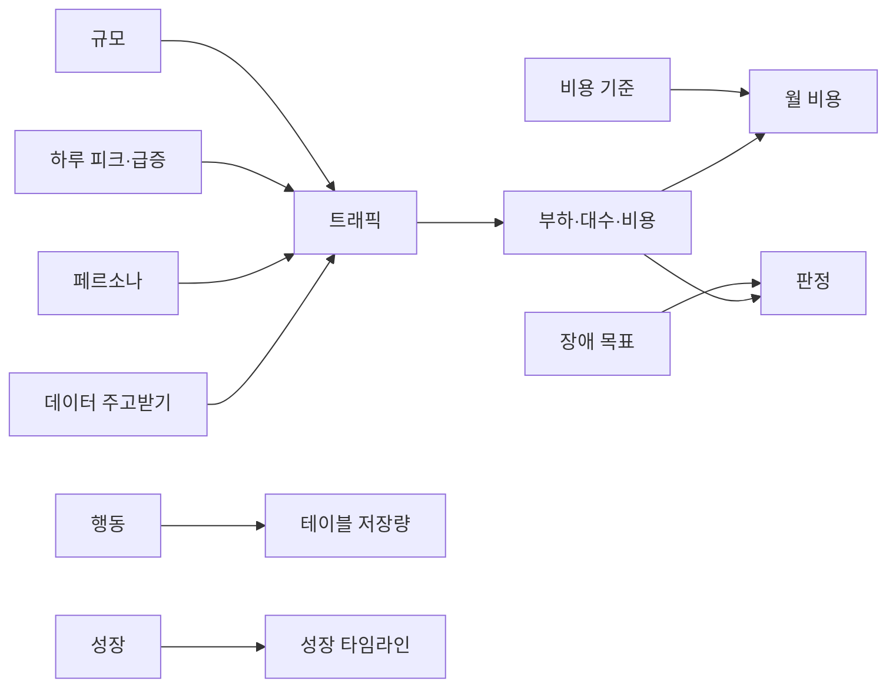

# 설정 화면

프로젝트 전체에 걸리는 입력값을 모은 화면입니다.

- 왼쪽 목차에 불러온 뒤 바꾼 항목 수가 노란 숫자로 나옵니다.
- **불러온 값으로 되돌리기**는 설정만 되돌립니다. 노드·연결선은 그대로이고, Ctrl+Z로 다시 돌릴 수 있습니다.

## 어떤 설정이 어디에 쓰이나



## 칸별 설명

| 칸 | 정하는 것 |
|---|---|
| 프로젝트 | 설계서에 나오는 이름 |
| 설계 메모 | 개요·범위·화면 구성·보안처럼 글로 적는 장. 순서대로 설계서 맨 앞 장이 됩니다. 아래 형식을 쓸 수 있고 미리보기로 확인합니다. **마크다운 문서 붙여 넣기**에 문서를 통째로 넣으면 `## 제목`마다 장으로 나눕니다(장이 있으면 뒤에 붙이기·모두 바꾸기). 설정 값이 아니라 "바뀐 항목"으로 세지 않고, **불러온 값으로 되돌리기**도 메모는 그대로 둡니다 |
| 구동 방식 | 웹·앱·로컬 실행 등. 로컬 실행은 서버 부하 대신 기기 메모리를 계산 |
| 규모 | 활성 사용자 수, 이벤트 배수, 보관 기간, 목표 사용률, 시드, 큐 적체 계산 단위(1·5·15·60분) |
| 하루 피크 | 업종 미리 설정, 봉우리 끌기, **일시적 급증**(횟수·이어지는 시간·높이 1.5배까지) |
| 페르소나 | 사용 패턴별 무리와 비율, 나라, 접속 횟수·시간 |
| 행동 | 주문·리뷰처럼 사용자가 하는 일, 쓰는 테이블과 행 수, 페르소나별 빈도 |
| 데이터 주고받기 | 폴링·스트리밍, 최신화 주기, 모아 보내기 (서비스 성격별 추천) |
| 성장 | 월 성장률 또는 유입 모형, 보는 기간, 준비 기간 |
| 비용 기준 | 기본 리전, 저장·송신·리전 간 전송·존 간 전송·로그 저장 가격 상품 |
| 장애 목표 | 견딜 장애(없음·존·리전), 목표 RTO·RPO |
| 인증·인가 | 사용자 인증 방식(없음·세션 쿠키·JWT·OAuth2/OIDC·API 키), 토큰을 발급하는 노드, 토큰 수명(분)·갱신 토큰, MFA(없음·선택·필수), 권한 모델(없음·RBAC·ABAC), 관리자 분리, 서비스 간 인증(없음·mTLS·서비스 계정). 인터넷 공개 노드나 화면이 바로 부르는 외부 서비스가 있으면 보안 점검과 STRIDE 위장·권한 상승 줄에 쓰이고, 비면 "미정"입니다 |
| 웹 클라이언트 보안 | 브라우저 쪽 방어 8칸(아래 절). 구동 방식이 웹·하이브리드이고 인증·인가 점검이 도는 프로젝트에서만 보안 점검과 설계서 표·명령줄 🌐 줄에 쓰이고, 비면 "미정"입니다 |
| 앱 | 이 PC의 앱 설정(프로젝트 파일에 들어가지 않음): 앱을 열 때 새 버전 확인(기본 켜짐) |

### 웹 클라이언트 보안

구동 방식이 웹·하이브리드가 아니면 판정에 쓰지 않습니다. 쿠키 칸은 쿠키 기반(인증 방식 세션 쿠키이거나 토큰 보관이 쿠키)일 때만, 토큰 보관은 JWT·OAuth2/OIDC일 때만 미정으로 묻습니다. 공개 gateway·backend 없이 화면이 외부 서비스(BaaS)만 부르면 CORS·HSTS는 사업자가 정하므로 묻지 않습니다. 인증 방식이 API 키이면 브라우저 번들에 키가 드러나므로 ⚠️입니다. 설정 화면은 문이 닫혀도 저장된 값이 있으면 칸을 보여 줍니다.
hybrid 웹뷰는 출처가 `capacitor://localhost` 또는 `null`이라 허용 목록에 그 값을 넣되 `null`은 허용하지 마세요. Electron(local_exe)은 문이 닫히지만 렌더러 CSP는 따로 중요합니다.

- **출처 허용(CORS)**: 다른 출처에서 오는 요청을 받는 범위. 끔(같은 출처만)·허용 목록·모든 출처(Origin 반사). 모든 출처는 쿠키 기반이면 ⚠️(자격 증명과 함께 반사), 토큰 기반이면 ℹ️
- **쿠키 SameSite**: 다른 사이트에서 보낸 요청에 쿠키가 붙는지. strict·lax·none
- **쿠키 HttpOnly**: 스크립트가 쿠키를 못 읽게 함. 끄면 XSS 한 번에 세션이 샘
- **쿠키 Secure**: https로만 쿠키를 보냄. 끄면 ⚠️ (SameSite=none은 Secure 없이는 브라우저가 거부)
- **CSRF 토큰**: 쓰기 요청에 CSRF 토큰을 요구. 쿠키 기반인데 없고 SameSite가 strict가 아니면 ⚠️ (lax는 다른 사이트의 POST만 막으므로 다층 방어로 토큰을 권장)
- **CSP**: 콘텐츠 보안 정책. 강제·보고만(ℹ️)·없음(⚠️)
- **HSTS**: Strict-Transport-Security 헤더로 http 끌어내림을 막음. 끄면 ⚠️
- **토큰 보관**: 브라우저가 로그인 토큰을 두는 곳. 쿠키·메모리·localStorage(⚠️)

### 업종 미리 설정

| 업종 | 깨어 있는 시간 | 피크 |
|---|---|---|
| 외식·배달 | 10~22시 | 12시 · **18시 반** |
| 라이브 게임 | 11~2시 | 13시 · **21시 반** (자정 넘어 이어짐) |
| 출퇴근 (교통·뉴스) | 6~23시 | **8시** · 12시 반 · **18시 반** |
| 업무용 (B2B·금융) | 9~18시 | **10시 반** · 15시 |
| 쇼핑·커머스 | 9~1시 | 13시 · **21시 반** |
| OTT·동영상 | 18~2시 | **22시** |

굵은 글씨가 더 큰 봉우리입니다.

업종을 누르면 피크 시각과 페르소나 비율이 함께 바뀌고, 그래프의 봉우리를 끌어 시각·폭·비중을 고칩니다(시각·비율은 **예시값**).

각 값이 계산에 어떻게 쓰이는지는 [계산 방식](model.md)에 있습니다.

### 설계 메모 형식

| 쓰기 | 설계서에서 |
|---|---|
| `### 소제목` (`#`~`######`) | 굵은 소제목 |
| `- 항목`, `1. 항목`, 들여 쓰면 안쪽 목록 | 글머리표·번호 목록 |
| `\| 칸 \| 칸 \|` 다음 줄 `\|---\|---\|` | 표 (첫 줄이 머리) |
| ```` ``` ```` 로 감싼 줄 | 고정폭 코드 블록 (줄바꿈·공백 그대로) |
| `> 인용`, `---` | 인용, 가로줄 |
| `**굵게**`, `` `코드` `` | 굵게, 고정폭 |

링크·이미지·HTML은 받지 않고 글자 그대로 보입니다. 노드 패널의 **설명**도 같은 형식이며 설계서 "노드별 선택과 판정 근거" 장의 노드 카드에 "메모"로 나옵니다(메모 장 수만큼 장 번호가 밀림).
