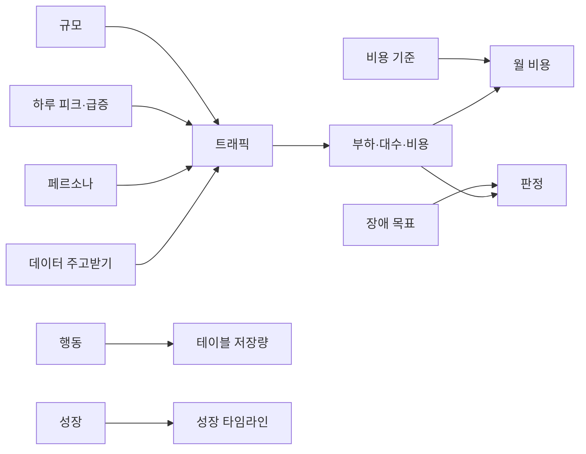

# 설정 화면

프로젝트 전체에 걸리는 입력값을 모은 화면입니다.

- 왼쪽 목차에 불러온 뒤 바꾼 항목 수가 노란 숫자로 나옵니다.
- **불러온 값으로 되돌리기**는 설정만 되돌립니다. 노드·연결선은 그대로이고, Ctrl+Z로 다시 돌릴 수 있습니다.

## 어떤 설정이 어디에 쓰이나

## 칸별 설명

| 칸 | 정하는 것 |
|---|---|
| 프로젝트 | 설계서에 나오는 이름 |
| 구동 방식 | 웹·앱·로컬 실행 등. 로컬 실행은 서버 부하 대신 기기 메모리를 계산 |
| 규모 | 활성 사용자 수, 이벤트 배수, 보관 기간, 목표 사용률, 시드, 큐 적체 계산 단위(1·5·15·60분) |
| 하루 피크 | 업종 미리 설정, 봉우리 끌기, **일시적 급증**(횟수·이어지는 시간·높이 1.5배까지) |
| 페르소나 | 사용 패턴별 무리와 비율, 나라, 접속 횟수·시간 |
| 행동 | 주문·리뷰처럼 사용자가 하는 일, 쓰는 테이블과 행 수, 페르소나별 빈도 |
| 데이터 주고받기 | 폴링·스트리밍, 최신화 주기, 모아 보내기 (서비스 성격별 추천) |
| 성장 | 월 성장률 또는 유입 모형, 보는 기간, 준비 기간 |
| 비용 기준 | 기본 리전, 저장·송신·리전 간 전송 가격 상품 |
| 장애 목표 | 견딜 장애(없음·존·리전), 목표 RTO·RPO |
| 앱 | 이 PC의 앱 설정(프로젝트 파일에 들어가지 않음): 앱을 열 때 새 버전 확인(기본 켜짐) |

### 업종 미리 설정

| 업종 | 깨어 있는 시간 | 피크 |
|---|---|---|
| 외식·배달 | 10~22시 | 12시 · **18시 반** |
| 라이브 게임 | 11~2시 | 13시 · **21시 반** (자정 넘어 이어짐) |
| 출퇴근 (교통·뉴스) | 6~23시 | **8시** · 12시 반 · **18시 반** |
| 업무용 (B2B·금융) | 9~18시 | **10시 반** · 15시 |
| 쇼핑·커머스 | 9~1시 | 13시 · **21시 반** |
| OTT·동영상 | 18~2시 | **22시** |

굵은 글씨가 더 큰 봉우리입니다.

업종을 누르면 피크 시각과 페르소나 비율이 함께 바뀌고, 그래프의 봉우리를 끌어 시각·폭·비중을 고칩니다(시각·비율은 **예시값**).

각 값이 계산에 어떻게 쓰이는지는 [계산 방식](model.md)에 있습니다.
